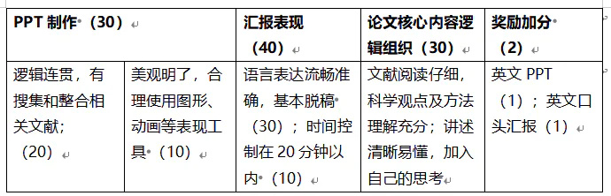

# 生物医学光学成像前沿导论

- **任课教师：** 李炫桢
- **学分：** 2.0
- **课程类别：** 专业课程选修
- **学期：** 2025-2026春

## 课程总结与建议

还是2学分，但今年变成每周两次课一次两课时，只有Lee一个人上。考试题目也加料了。我听说24级成像好像把原来Lee的光学部分剔除了，应该是想把这部分完全独立出来放在这门课里。老师英语和中文都很好，尤其英语听着很舒服。但是由于全英语授课可能还是难度过大，可能听到专业的词汇、就没太听懂，所以只建议英语水平比较好和对光学成像感兴趣的内容听课。因为我高中没学生物，所以上课讲到很多关于细胞学的都没怎么听懂
考核是10考勤+20作业+30pre+40期末考。考勤有pop quiz，题目都很简单。然后pre阶段给别的组的打分也算考勤了。
作业assignment5次，每年题目略有区别，不过问AI就好，但是不要直接复制。
pre的话是选一篇论文讲解，这次是5人一组，英语ppt和英语演讲现在分别只+1分了，我觉得要是讲不清楚就老老实实中文好了，我们组就是ppt英文，但是中文讲的。Lee还会给comment，告诉你有什么问题。

考试是半开卷的，可以带一张手写A4和计算器，这次大部分题目结合自己理解和作业题、历年卷还是可以覆盖的，最后A4是要交上去的。我就抄了作业和历年题，因为规划的不好，比较乱，同一个内容会分布在不同地方。我建议根据章节内容把作业和历年题同一个知识下的抄在一起，用不同颜色笔标注，最好再根据ppt用一两句中文注释。
今年有29题，剩下的我记不清了，还有几个选择和选词填空记不全，欢迎楼下补充

[返回专业课程列表](index.md)
{ .article-backlink }
