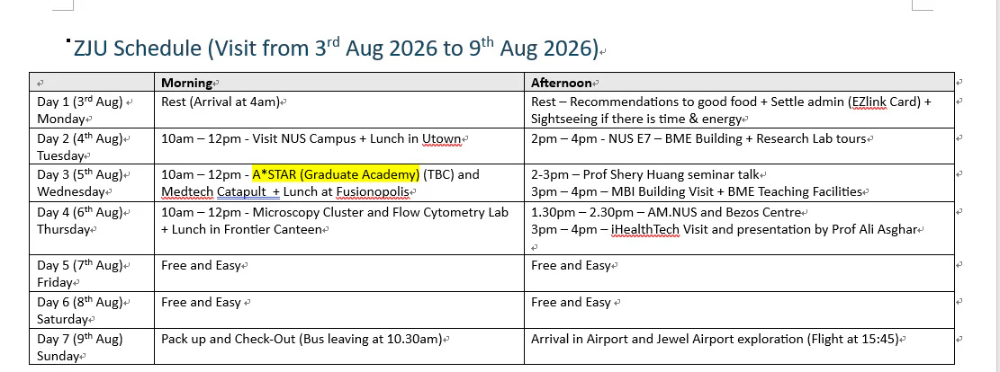
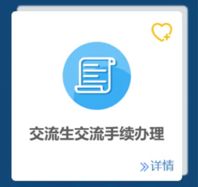
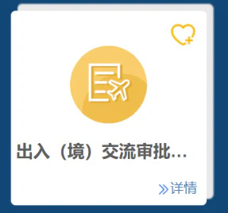

# 生仪学院暑期NUS交流

[原帖](https://www.cc98.org/topic/6662909){ target="_blank" rel="noopener noreferrer" }

- 总体印象

    1. 今年是在8月2-9号，一般是在7月中下旬，今年因为过年晚整个导致春夏学期延后，参考是大三短学期7月24才结束。六月院网发通知，然后交一个表和一些材料。今年去了21个，没有选拔。我估计除非人数实在太多（比如30个），不然应该都是报了就给进的

    2. 三天是有安排的，其他时间自由。（注意是2号晚上飞机，3号凌晨到的）然后当时梁波老师组织带去南洋理工参观了半天，但这个是自愿去的，不在计划内

    

    3. 各种讲座和实验室参观个人感觉下来那边还是偏向传统bme或者说是生物方向（比如有几个带我们参观的zju本科的学长本科其实是生物），诊疗的同学估计听着还行，我是仪器的，感觉不太对口。关于英语，大概有一半PI或者带教会说中文，英文交流的话用豆包就能翻译了。如果想自己听懂的话最关键是能听懂对方介绍的核心概念，因为不对口导致有两次对方介绍的核心词我不知道是什么东西或者说看到翻译的名词也不知道是什么，就会导致整段听不懂在说什么……至于吃饭买东西什么的，只能说大部分时间我都在讲中文，所以完全不用担心

    4. 印象比较深的是那边的老师说，他们本科就业率在99%以上，一届可能就一两个会继续读phd或者硕士，然后他们大三有专门一门课程就是安排学生去企业实习，并且学校会要求对方不能让学生打杂，必须参与实际的工作。国内在这一块确实是任重道远

    5. 总体还是比较轻松的，也有很多时间到处走走，还可以完成四课和国际化要求，而且学校能报销5k，个人比较推荐出去看看

- 准备

    1. 去程是要求所有同学买同一班飞机一起杭州出发，回来的话可以不跟大部队回杭州，但目的地必须是国内。我当时就是自己走的

    2. 酒店会指定地方。两人一间，自己组队自己订房。我们买了含早的，因为国外吃早饭其实很麻烦，不像国内到处有早餐店，我建议买含早，这样早上也能起晚一点

    3. 出行第一和最后一天，机场酒店之间会安排大巴，平时出门，包括从酒店去nus都需要坐地铁

    4. 吃饭分食阁和restaurant，食阁就类似食堂一样，有很多窗口自己去买然后端到位子上吃，普通的一份套餐6、7新差不多了，吃的豪华一点10新也完全够。restaurant就是常规意义上的饭店，点菜的那种，两个人一顿基本就要接近50新甚至更多了

    5. 记得带一个转换头

    6. 网络我是自己在淘宝买的流量卡，一天也就7块左右吧，记不太清了。我建议是自己买国内邮寄到手的，不要买那种到对方机场拿的，太麻烦

    7. 坐地铁visa/MasterCard的银行卡是可以直接在闸机上刷的，不然需要办交通卡。如果你是苹果可以把你的银行卡绑定到appleWallet上，然后就可以刷手机不需要带实体卡了

    8. 我自己带了一张visa卡，一张学校办的中国银行的银联，现金带了500新。visa/MasterCard卡是所有场合都能用的，但是汇率不太好。支付宝或者微信其实完全能覆盖90%以上使用场合，汇率还有一点点优惠。现金我只有在食阁吃饭的时候用到过，个人感觉换个200就够。银联的卡部分商家可以用，比较有意思的是去的时候在滨海湾花园买门票用银联有满减。

    9. 机票来回花了3k，酒店平摊下来一人5k，交通大概180块，其他开销包括花了2.6k左右吧。我是偏享受的，所以这个2.6k里有很多非必要支出，比如景点门票和各种吃吃玩玩，然后正餐大概一半食阁一半restaurant。如果省一点1.8k甚至1.5k应该也够用。不过今年因为整体交流时间延后，和旅游季重叠，导致机酒相比去年上涨很多，而且越接近出发日越贵，组好队就早点买。我问去年的同学机酒加起来才5k多，只能说今年timing确实不好。

    10. 因为买的酷航是廉航，要托运记得买行李额度

- 回来之后

    1. 去之前需要在zdbk上报名对外交流，之后就按照上面的流程一步步交材料就好了
    

    2. 除了上面一步还需要在zdbk上办出入境审批，这是报销用的
    
    3. 学校的报销下来后，可以把额度给另一位同学一起报销。因为刚好两人酒店1w多点刚好覆盖两人加起来1w的报销额度，所以我跟同行的同学就一起报的。

    4. 流程是先在计财处的网站填信息预约报销单，然后线下交材料。不需要预约的当天才能去，在预约的时间之前任何一天交材料都可以，也不需要本人去交，因为就是把材料放在指定地方就好了。我9.30交的，10.8就到账了。玉泉的计财处在地图上搜会计核算中心就能找到

    5. 我交的报销材料：
        - 计财处预约单
        - 2人的出境审批单和入境审批单（就是上面2那个）
        - 2人的出入境记录（在支付宝上可以查到）
        - 对方邀请信
        - 乘坐非国内航空公司航班和改变中转地审批表（因为坐的是酷航）
        - 发票（酒店入住记录、酒店发票等，反正携程发给你的全都交上去就完了；其中电子发票打印出来需要两人签字；报机票什么的也都行，加起来总额大于1人5k或者2人1w就行）
        - 支付宝付款记录

        （有些是要学院盖章签字的，找宣老师就好）

    6. 学院有要求产出一份中英文新闻稿和宣传画册，大家分配一下任务就好了，简单的

[返回其他文章列表](index.md)
{ .article-backlink }
